<!-- Side-by-side: ASCII Portrait & Terminal Stats -->
<table>
  <tr>
    <td width="50%" valign="top">
      
    </td>
    <td width="50%" valign="top">
      
    </td>
  </tr>
</table>

 

<!-- System Info Card -->

 

<!-- Contribution Heatmap -->

